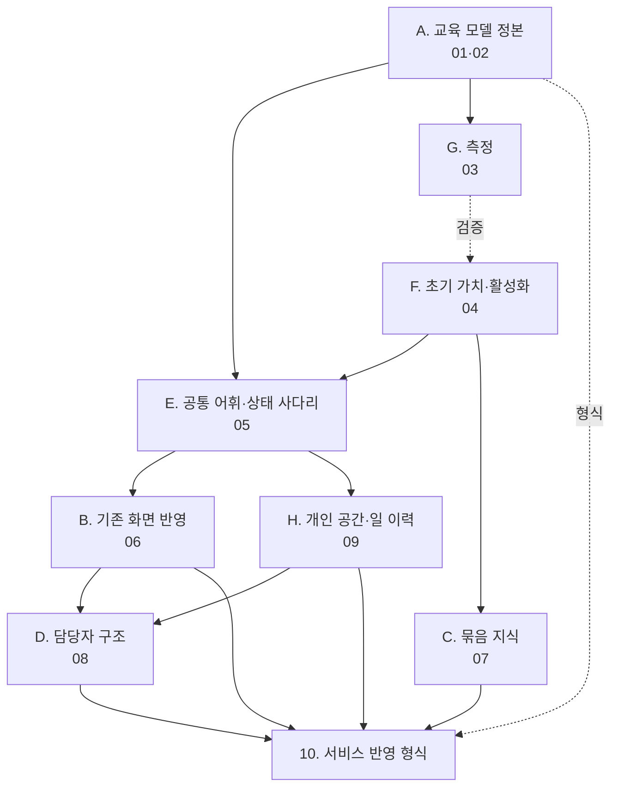

# 교육 설계 문서 — 개요와 관계도

작성 2026-10-31. "알바 교육"을 핵심 브랜딩으로 가져가기 위해 교육 과정과 프로세스를 개념부터 정리한 문서 묶음이다.
원본 작업은 Claude 문서(https://claude.ai/artifact/WL1Gkg5FpwCtrDZ6Fy4haH)와 흐름도 HTML(https://claude.ai/artifact/Wo6hDQbaxYVEW41aPCQdnQ)에 있고, 이 폴더는 그 내용을 주제별로 나눠 저장소에 남긴 정본이다.

## 한 줄 정의

매장의정석의 교육은 **사장 머릿속 암묵지를, 알바가 현장에서 혼자 할 수 있는 행동으로 옮기는 과정**이다. 퀴즈는 그 과정의 확인 장치이지 교육 그 자체가 아니다. 성공 기준은 퀴즈 통과가 아니라 "그 일을 사장 없이, 안 묻고, 틀리지 않게 하는가"다.

## 문서 목록

| 번호 | 파일 | 주제 | 성격 | 분기 |
| --- | --- | --- | --- | --- |
| 00 | 이 문서 | 전체 지도, 관계, 읽는 순서 | 안내 | — |
| 01 | `01_교육_모델_정본.md` | 정의, 개념 사전, 6단계, 학습 루프 | 정본 (참조) | A |
| 02 | `02_지식_분류.md` | 요식업 지식 10유형, 학습 방식 5, 세 묶음, 교육학 축 | 정본 (참조) | A |
| 03 | `03_측정.md` | 학습이 되었는가의 4층 지표, 활성화 지표 | 정본 + SQL 과제 | G |
| 04 | `04_초기_가치_활성화.md` | 노하우 4개·직원 0명에서 가치, 4문답, 대화 구현, 허들 1 방안 | 기획 (지금 핵심) | F |
| 05 | `05_공통_어휘와_상태_사다리.md` | 두 말투 한 사다리, 금지 어휘, 확인법 동사 | 기획 (공통 언어) | E |
| 06 | `06_기존_화면_반영.md` | UI 지도, 직원·사장 경험, 노하우 여정, 작업 16건 | 기획 (소·중 작업) | B |
| 07 | `07_묶음_지식_자리지도.md` | 자리 20개 같은 지식, 자리 지도 노하우, 사진에서 찾기 | 기획 (새 데이터 유형) | C |
| 08 | `08_담당자_구조_선배.md` | 선배가 가르치는 구조, 자격, 사수 할일, 허들 2 방안 | 기획 (새 구조) | D |
| 09 | `09_개인_공간과_일_이력.md` | 알바의 내 공간, 사장 없는 인수인계, 일 이력 카드 | 기획 (새 공간 계층) | H |
| 10 | `10_서비스_반영_형식.md` | 데이터·확인 경로·상태·코스·화면·측정의 형식, 간극 목록 | 기획 → 구현 명세 전 단계 | 전체 |

## 분기의 관계

읽는 법: 화살표는 "앞이 있어야 뒤가 의미 있다"는 의존이다.

- **A(정본)**는 화면에 나오지 않는다. 다른 모든 문서가 쓰는 말과 틀을 제공한다.
- **F(초기 가치)**가 실행 순서의 첫 번째다. 쓸 사장이 생겨야 나머지가 가치를 갖는다.
- **E(어휘)**는 값이 싸고 F·B·D가 전부 같은 말을 써야 하므로 F 바로 뒤에 고정한다.
- **B(기존 화면)**는 새 기능이 아니라 있는 숫자와 버튼의 뜻을 바꾸는 일이다.
- **C(묶음 지식)**와 **D(담당자 구조)**는 직원이 있고 노하우가 쌓인 매장에서만 가치가 있다.
- **H(개인 공간)**는 D의 바닥이다. 선배의 기록이 사람을 따라가야 담당자 구조가 선배에게 가치 있다.
- **G(측정)**는 F가 실제로 작동하는지 검증하는 자리다. 데이터는 이미 있고 집계만 없다.
- **10(서비스 반영 형식)**은 모든 분기가 최종적으로 데이터·화면·규칙으로 어떻게 들어가는지를 한 표로 모은다.

## 실행 순서

| 순서 | 분기 | 왜 이 자리인가 |
| --- | --- | --- |
| 1 | F 초기 가치 | 노하우 4개·직원 0명인 사장이 10분 안에 가치를 봐야 나머지가 쓰인다 |
| 2 | E 공통 어휘 | 문구·상태 계산만으로 끝나고 이후 모든 작업이 같은 네 단어를 쓴다 |
| 3 | B 기존 화면 | 소·중 작업 16건. "퀴즈 앱"을 "교육 앱"으로 읽히게 하는 경계선 |
| 4 | G 측정 | 콘솔 전용 SQL. 새 테이블 없음 |
| 5 | H 개인 공간 | 사장 없는 매장에서도 시작되고, 선배 기록이 사람을 따라간다 |
| 6 | C 묶음 지식 | 자리 지도 노하우 유형 + 사진에서 찾기 문항 |
| 7 | D 담당자 구조 | 자격·사수 할일·칸별 확인 권한 |

## 핵심 주장 다섯 가지 (문서 전체를 관통)

1. **교육의 단위는 노하우 한 개, 묶음 단위는 업무.** 설거지는 자리 + 절차 + 기기 + 안전이 합쳐진 업무이고, 교육은 업무 단위로 묶되 지식 유형별로 다르게 가르친다.
2. **상태는 머릿속이 아니라 둘이 같이 본 행동으로 쓴다.** 보여줬다 → 같이 했다 → 시켜봤다 → 맡겼다. 알바 말로는 봤어요 → 같이 했어요 → 혼자 했어요 → 맡았어요.
3. **퀴즈가 본업인 영역은 암기 하나다.** 숙련·판단에서는 보조, 감각·습관에서는 거의 무력하다. 매장 교육의 체감 난도는 숙련과 습관에서 나오고, 그 도구는 할일·루틴·체크리스트다.
4. **사장은 "예"를 누르지 않고 "아니오"만 누른다.** 기본값은 코드와 선배가 정하고 사장은 예외만 막는다.
5. **사장 행동 하나당 즉시 가치 하나.** 직원 합류 전에 미리보기·직접 풀기·링크 결과로 세 번의 가치가 나와야 한다.

## 열린 결정 (사람이 정해야 할 것)

- 교육의 성공 기준을 "혼자 할 수 있다"로 못 박는 데 동의하는가.
- 단계별 시기(첫 3일, 1~2주, 3~8주, 2개월)는 추정값이다. 실제 매장 경험과 맞는가.
- 파지·행동 지표를 운영 콘솔에만 먼저 둘지, 사장 화면에도 올릴지.
- 사장 하단 탭 이름을 '퀴즈'에서 '교육' 또는 '알려주기'로 바꿀지.
- 사장 관찰 입력(월 1회 한 문항)을 넣을지.
- 알기·하기·겪기 꼬리표를 사장이 고르게 할지, 코드가 추론할지(제안: 코드 추론 + 사장은 뒤집기만).
